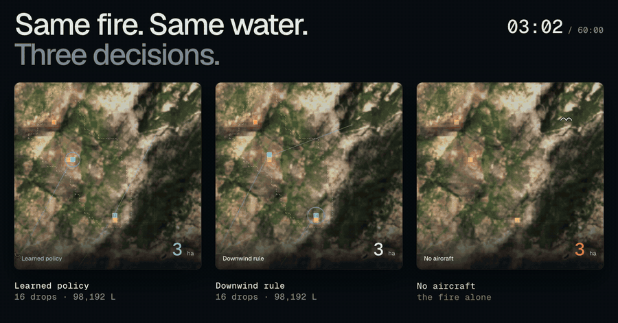
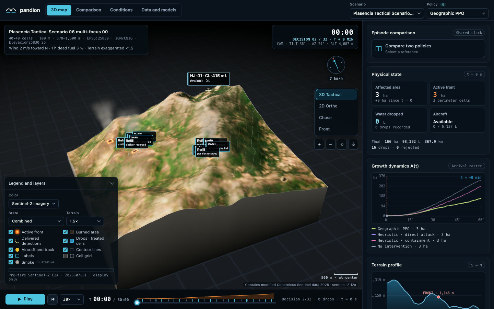

# Pandion

[](https://github.com/MrJuandi/pandion/actions/workflows/tests.yml)


**Where should the next drop go?** Pandion is a research simulator for wildfire response. A reinforcement-learning policy decides where and when water-dropping aircraft act, and is evaluated against transparent rules that receive the same delayed information.



*One illustrative held-out episode (Plasencia, Spain; two aircraft, one hour). It is not the average result: see [Results](#results). Contains modified Copernicus Sentinel data 2025 and Copernicus EMS products. Wind and ignitions are synthetic.*

**Status:** early research prototype. Physical validation is open, the water-effect rule is provisional, and this is not an operational decision tool.

## Research question

Can a learned policy choose where and when to deploy firefighting resources more effectively than transparent baselines when all controllers receive the same delayed and uncertain information?

## Results

Final burned area on 288 scenarios from one held-out activation (EMSR837), two aircraft, three training seeds. Paired difference, policy − reference, in hectares with 95 % bootstrap intervals; lower is better.

| Policy | − downwind heuristic | − hold-aware rule |
|---|---|---|
| PPO with branched advantages | **−3.09** [−4.52, −1.88] | −0.03 [−0.44, +0.35] |
| PPO with Monte Carlo/GAE advantages | −1.03 [−1.62, −0.53] | +2.02 [+1.04, +3.28] |

The learned policy beats the downwind heuristic and **ties, but does not beat,** the hold-aware rule. Branching the advantage estimates accounts for about 2 ha of the gain. Limits: one held-out activation, three seeds, simulator only. The full record, including negative results, is in [EVALUATION.md](docs/EVALUATION.md).

## What is built

- **Simulator:** surface-fire spread from standard fuel models, and a CL-415 reference aircraft that travels, drops, returns and refills.
- **Real geography:** scenarios from Copernicus EMS activations, with sourced elevation, land cover and pre-fire Sentinel-2 imagery, recorded with provenance and hashes.
- **Policies:** a PPO training pipeline and transparent references (downwind, containment and hold-aware rules).
- **3D workspace:** an offline viewer to replay and compare episodes.



*The bundled viewer at the start of the Plasencia episode above (learned policy).*

## Quick start

The synthetic example needs only Python 3 and the standard library:

```sh
mkdir -p runs
python3 -m pandion.integrated examples/synthetic_integrated.json --policy heuristic --output runs/integrated-heuristic.json
python3 -m pandion.viewer runs/integrated-heuristic.json --output runs/heuristic-viewer.html
```

Open `runs/heuristic-viewer.html` in a browser. Run the tests with `python3 -m unittest discover -s tests -v`.

To see the project page and the bundled 3D replay, run `python3 -m http.server` from the repository root and open `http://localhost:8000/site/`. Real-terrain scenarios, training and evaluation are covered in [USAGE.md](docs/USAGE.md).

## How it works

```text
Data sources ──> scenario builder ──> simulator true state
                    │                       │
                    └──> observation model <─┘
                              │
                    controller or baseline
                              │
                    mission and action order
                              │
                      resource dynamics
                              │
                     evaluation and replay
```

The simulator's true state is kept separate from what a controller can observe. See [system architecture](docs/ARCHITECTURE.md).

## Design principles

- **Physical state and observed state are separate.** The simulator tracks the best justified approximation of the fire and resources. A controller sees only information that its specified sensors and data feeds could have delivered by that time.
- **Spatial data has provenance.** Every terrain, land-cover, weather, population, and fire-observation layer records its source, resolution, timestamp, transformation, and uncertainty. A real elevation layer does not make every other layer real.
- **Actions have operational consequences.** Orders consume time and resources. Aircraft travel, drop, return, and refill; they do not teleport.
- **Results are reproducible.** Scenarios, seeds, simulator version, controller version, training settings, and evaluation splits are recorded. Checkpoints are selected on validation data; the reserved test is not used for tuning.
- **Claims follow evidence.** A policy can outperform a baseline in a simulator without being safe or effective in a real incident. Failures and worst cases are reported alongside averages.

## Roadmap

The project moves from one aircraft to two, and then to heterogeneous resources. Each stage has its own evidence gate; none is claimed complete. See [ROADMAP.md](docs/ROADMAP.md).

## Documentation

- [USAGE.md](docs/USAGE.md) — full command reference: scenario families, training, evaluation, 3D workspace and interface notes.
- [RESEARCH_WORKFLOWS.md](docs/RESEARCH_WORKFLOWS.md) — reproducible scenario seeds, current checkpoint inference, multi-aircraft replay, searchable artifact catalog and incident-group report audits.
- [ARCHITECTURE.md](docs/ARCHITECTURE.md) — state, observation, actions, reward, policy, and growth to multiple resources.
- [PHYSICAL_MODEL_V0.md](docs/PHYSICAL_MODEL_V0.md) — sourced surface-fire and CL-415 references, implemented FM1 subset, and remaining validation limits.
- [STANDARD_FUEL_PATH.md](docs/STANDARD_FUEL_PATH.md) — standard-fuel scenario, reproduction command, boundaries, and ordered steps toward real maps.
- [DATA_AND_VALIDATION.md](docs/DATA_AND_VALIDATION.md) — candidate data, provenance, calibration, and validation requirements.
- [VALIDATION_EMSR578.md](docs/VALIDATION_EMSR578.md) — audited independent burned-area snapshots and the reasons they cannot yet validate FM1 spread.
- [VALIDATION_ANNABURROO.md](docs/VALIDATION_ANNABURROO.md) — no-fit comparison of FM1 head rate with experimental grass fires.
- [TRAINING_READINESS.md](docs/TRAINING_READINESS.md) — evidence gate for physical claims and the separate scope of exploratory synthetic training.
- [TRAINING_PERFORMANCE.md](docs/TRAINING_PERFORMANCE.md) — measured training costs, acceleration alternatives, and the quality checks needed before adopting them.
- [EVALUATION.md](docs/EVALUATION.md) — baselines, splits, metrics, statistics, and failure analysis.
- [ROADMAP.md](docs/ROADMAP.md) — milestones and acceptance criteria.
- [DECISIONS.md](docs/DECISIONS.md) — settled choices and open decisions.
- [REFERENCES.md](docs/REFERENCES.md) — related research and official data sources.
- [PUBLICATION_CHECKLIST.md](docs/PUBLICATION_CHECKLIST.md) — checks before creating and publishing the GitHub repository.
- [MAINTENANCE.md](docs/MAINTENANCE.md) — documentation ownership and change review rules.
- [site/](site/index.html) — static project page. Serve the repository root with `python3 -m http.server` and open `/site/`. Its replay is copied, not recomputed, from a built workspace by `python3 site/extract_episode.py <workspace>/index.html`, which writes `site/data/` and `site/viewer.html`, the offline 3D viewer for the same scenario that the page links to.

## Scope and limitations

Pandion is a research environment. Early scenarios will use a mixture of observed and modeled data, with each layer labeled. No model should be used to direct real firefighting operations without independent physical validation, operational review, and appropriate human oversight.

## License and citation

The project license, data redistribution rules, and citation metadata will be chosen by the project owner before public release. Until then, no license is asserted for this new project or for materials in the earlier FireLab-RL prototype.
